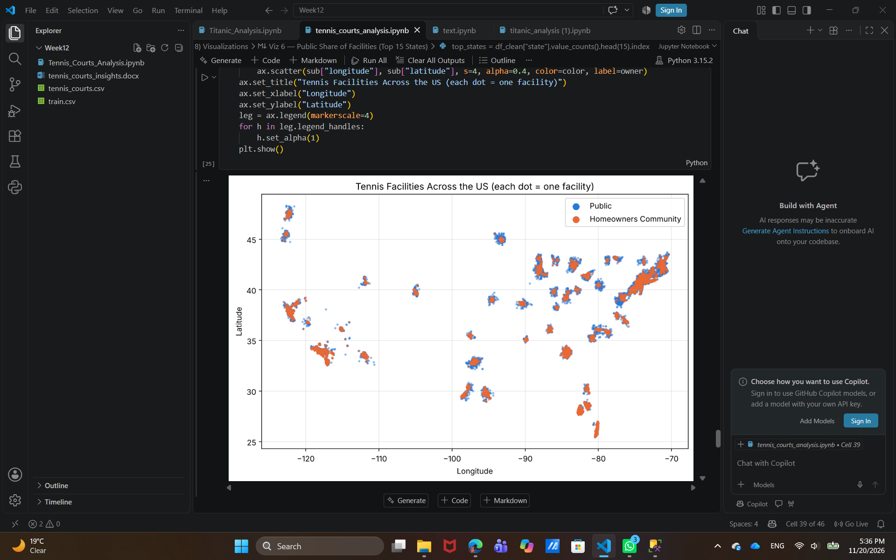
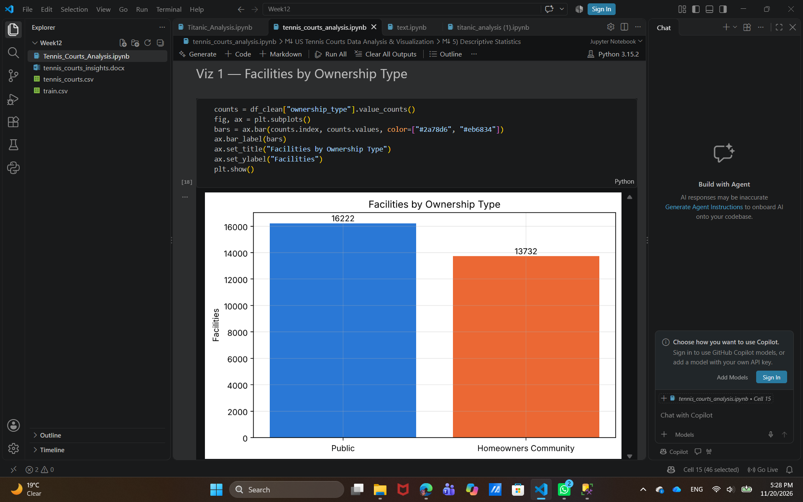
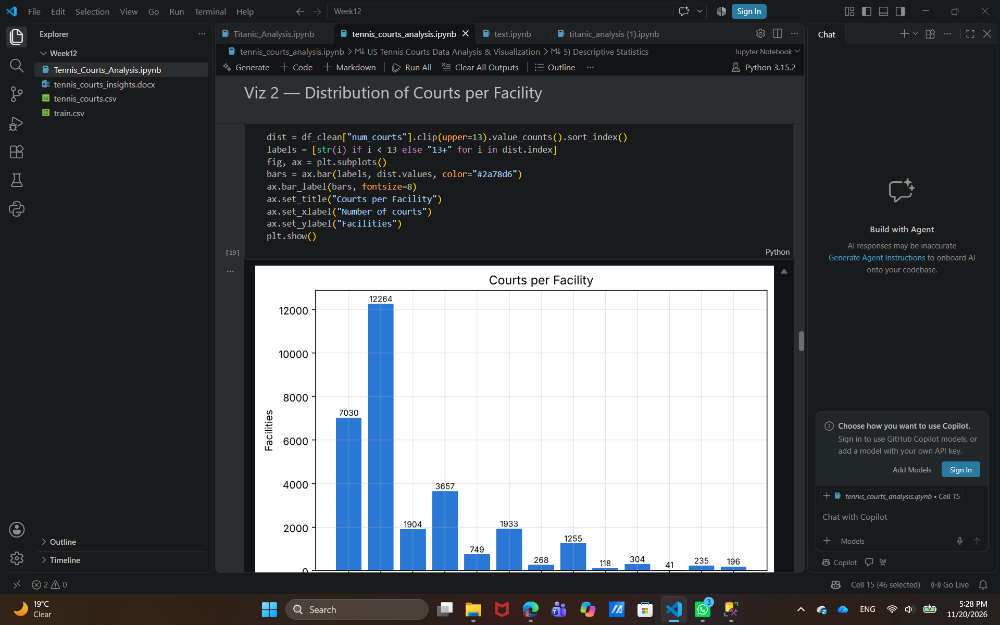
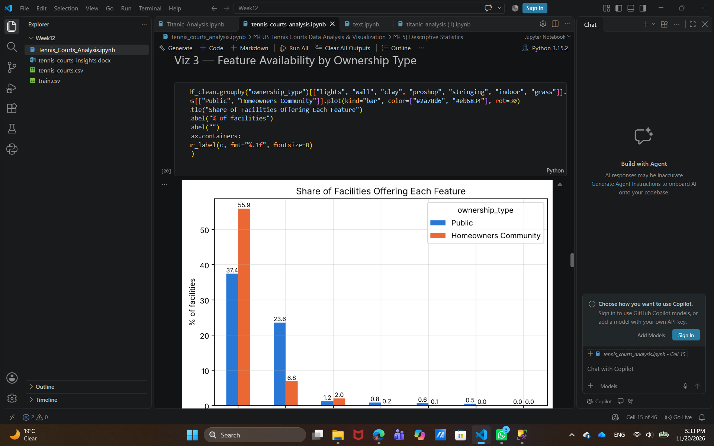
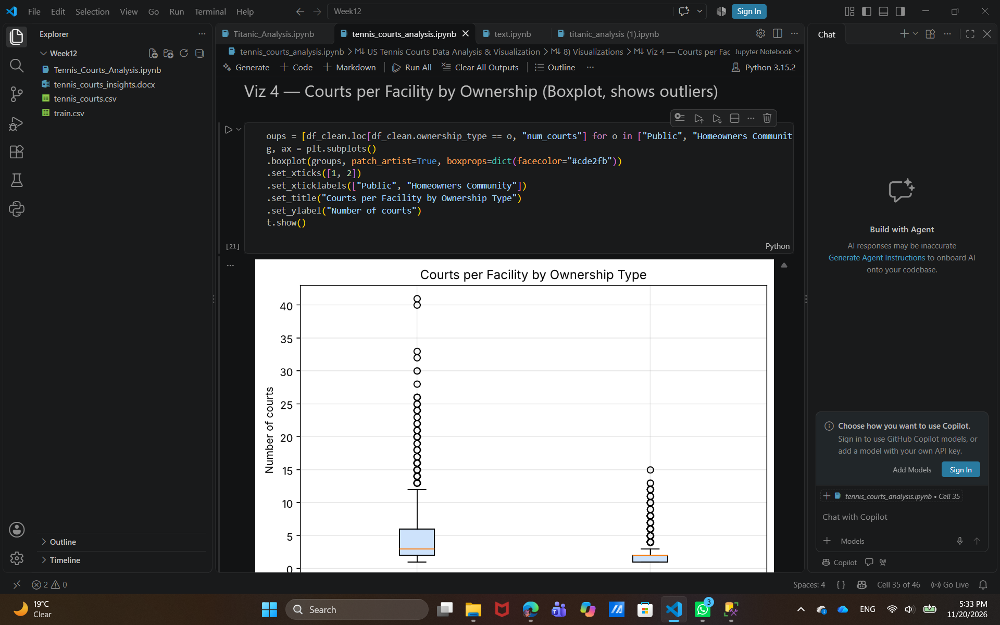
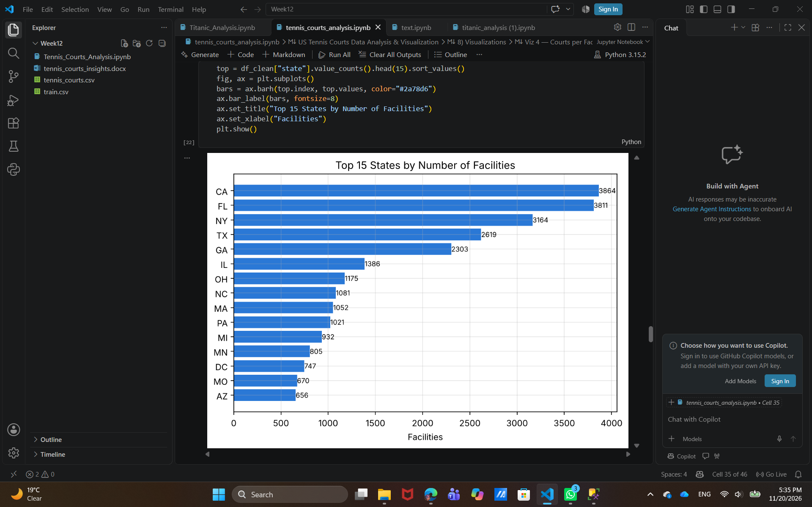
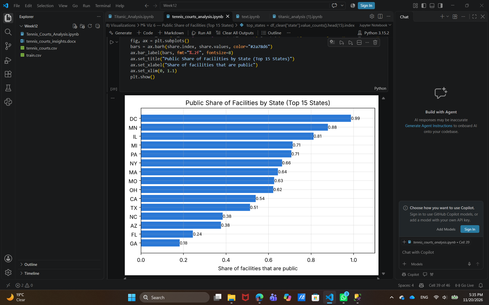
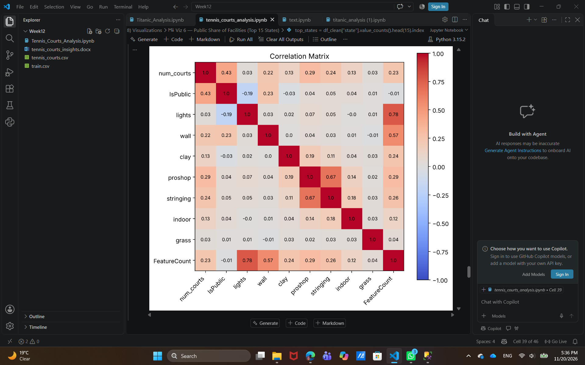

# 🎾 US Tennis Courts Data Analysis & Visualization Using Python

  

  <b>Data Cleaning | Exploratory Data Analysis | Feature Engineering | Statistical Analysis | Data Visualization</b>

---

## 📌 Project Overview

This project focuses on analyzing tennis court facilities across the United States using Python.

The analysis investigates facility ownership, court capacity, available amenities, geographical distribution, and relationships between facility characteristics to uncover meaningful patterns and insights.

A major part of the project involved identifying and correcting a data quality issue in the original dataset, where column headers were shifted and did not match the actual data.

The project covers the complete data analysis workflow, from data inspection and cleaning to feature engineering, statistical analysis, anomaly detection, and visualization.

## 🎯 Project Objectives

- Import and inspect the dataset using Pandas.
- Identify and investigate data quality issues.
- Correct misaligned column names and validate the original data.
- Handle missing values and duplicate records.
- Perform Exploratory Data Analysis (EDA).
- Engineer new features for deeper analysis.
- Calculate descriptive statistics and correlations.
- Analyze facility ownership and court capacity.
- Explore geographical distributions across US states.
- Detect outliers and potential anomalies.
- Create visualizations using Matplotlib.
- Generate analytical insights and recommendations.

## 🛠️ Tools & Technologies

| Tool | Purpose |
|---|---|
| Python | Data analysis and processing |
| Pandas | Data manipulation and cleaning |
| NumPy | Numerical operations |
| Matplotlib | Data visualization |
| Jupyter Notebook | Interactive analysis environment |

## 🔍 Data Quality Investigation

During the initial inspection, a major data quality issue was discovered: **the dataset column headers were shifted by one position**, meaning the column names did not correspond to their actual values.

For example:
- `city` contained state codes.
- `state` contained ZIP codes.
- `zip_code` contained ownership types.
- `longitude` contained a JSON-like attribute string.

### Data Validation

Instead of simply renaming the columns, the original values stored inside the `attributes_raw` column were used to validate the corrected data.

The validation achieved a **100% match** for the checked attributes, including:

- Facility ownership type.
- Number of courts.
- Clay, wall, grass, indoor, and lighting availability.
- Pro shop availability.

This investigation ensured that the dataset was correctly interpreted before proceeding with the analysis.

## 🔄 Data Preparation & Cleaning

The dataset was prepared through several cleaning steps:

- Correcting column names based on their actual data.
- Validating corrected columns against the original attribute information.
- Standardizing facility names, state codes, and metro area names.
- Converting ZIP codes into five-digit text values while preserving leading zeros.
- Extracting hidden attributes such as stringing services and facility quality ratings.
- Identifying and removing duplicate records.
- Removing facilities with zero courts.
- Checking remaining missing values after cleaning.

### Data Quality Summary

| Issue | Action |
|---|---|
| Shifted column headers | Corrected and validated |
| Duplicate records | 4 rows removed |
| Invalid court counts | 1 facility removed |
| ZIP code formatting | Converted to five-digit text |
| Hidden attributes | Extracted from original text |
| Missing values | Inspected and evaluated |

## ⚙️ Feature Engineering

Several new features were created to support more detailed analysis.

| Feature | Description |
|---|---|
| `IsPublic` | Indicates whether a facility is publicly owned |
| `FeatureCount` | Total number of available facility features |
| `HasAnyFeature` | Indicates whether a facility offers at least one feature |
| `IsLarge` | Identifies facilities with five or more courts |
| `SizeGroup` | Categorizes facilities based on court capacity |
| `stringing` | Indicates stringing service availability |
| `IsRated` | Indicates whether a facility has a quality rating |

## 📊 Exploratory Data Analysis (EDA)

The analysis explored multiple aspects of tennis facilities:

- Dataset structure and data types.
- Missing-value distribution.
- Descriptive statistics.
- Mean, median, mode, standard deviation, skewness, and kurtosis.
- Facility ownership distribution.
- Court capacity and facility size groups.
- Top states and metropolitan areas.
- Amenity availability.
- Public vs. homeowners community facility comparisons.
- Pivot table analysis.
- Correlation analysis.

## 📈 Data Visualizations

Eight visualizations were created using Matplotlib to explore facility characteristics, ownership patterns, and geographical distribution.

### 1. Facilities by Ownership Type

Compares the number of public facilities and homeowners community facilities.

  

### 2. Distribution of Courts per Facility

Explores the distribution of court capacity across tennis facilities.

  

### 3. Feature Availability by Ownership Type

Compares the availability of lights, practice walls, clay courts, pro shops, stringing services, indoor courts, and grass courts across ownership types.

  

### 4. Courts per Facility by Ownership Type

Uses a boxplot to compare court capacity across ownership types and identify potential outliers.

  

### 5. Top 15 States by Number of Facilities

Identifies the states with the highest number of tennis facilities.

  

### 6. Public Share of Facilities by State

Compares the proportion of public facilities across the top 15 states.

  

### 7. Correlation Heatmap

Visualizes relationships between numerical variables, ownership, and available facility features.

  

### 8. Geographical Distribution of Tennis Facilities

Uses longitude and latitude coordinates to visualize tennis facility locations across the United States, distinguishing between public and homeowners community facilities.

  

## 🔗 Correlation Analysis

A correlation matrix was generated to investigate relationships between court capacity, ownership, and available amenities.

Key findings included:

- Public ownership had the strongest positive correlation with the number of courts (r = 0.43).
- Pro shop availability showed a positive correlation with court capacity (r = 0.29).
- Stringing services were positively associated with court capacity (r = 0.24).
- Pro shop availability and stringing services showed a strong positive relationship (r = 0.67).
- Lighting availability had almost no correlation with court capacity (r = 0.03).

**Note:** Correlation indicates association, not causation.

## 🔎 Anomaly Detection

Potential outliers and unusual records were investigated using the Interquartile Range (IQR) method.

The analysis covered:

- Number of courts per facility.
- Total available facility features.
- Geographic coordinates outside the continental United States.
- Facilities with unusually high court capacity.

### Key Findings

- 2,149 facilities (7.2%) were identified as outliers based on court count.
- The largest facility contained 41 courts.
- These outliers were retained because they represented actual large tennis complexes rather than confirmed data errors.
- No coordinates were found outside the defined continental US boundaries.

## 💡 Key Analytical Insights

The analysis revealed several important patterns:

1. **Public Facilities Dominate Court Capacity:** Public facilities represent 54.2% of all facilities but account for 72.0% of total courts, with an average
